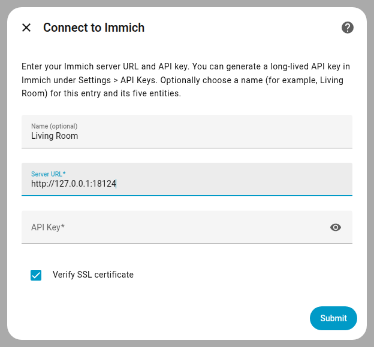
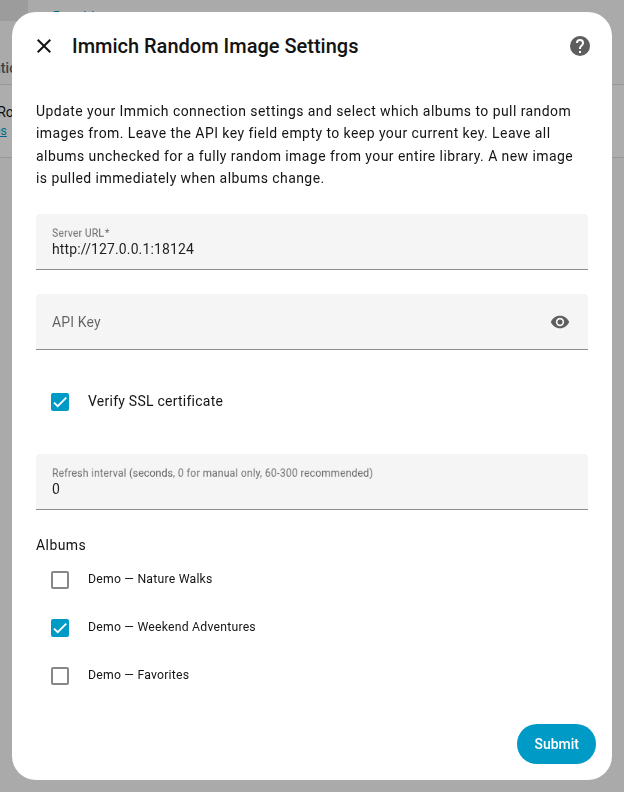
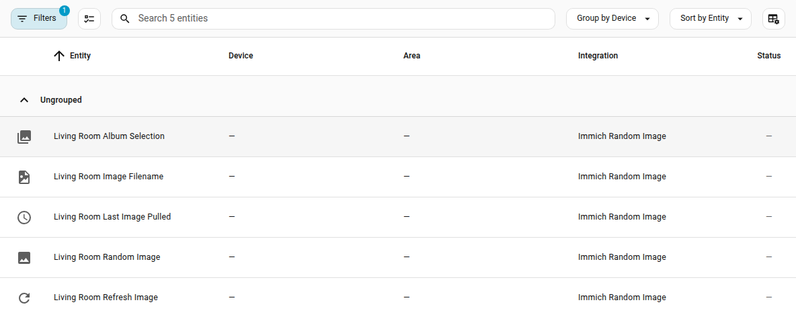
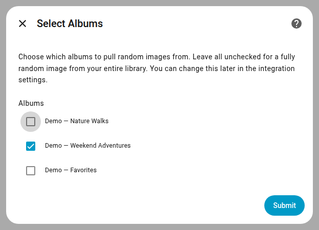
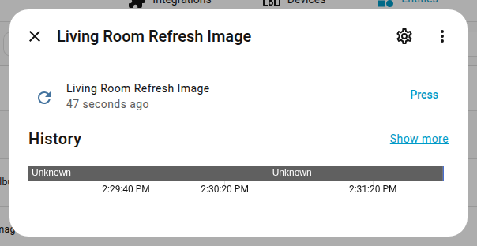

# Immich Random Image for Home Assistant


I got tired of old Home Assistant add-ons that would break when Immich updated their APIs, so I created a custom integration for Home Assistant that displays random images from your Immich instance on your dashboards. Built for Immich v3+ using the current `/api/search/random` endpoint.

> **Looking for the original integration?** The previous [immich-home-assistant](https://github.com/outadoc/immich-home-assistant) integration by [@outadoc](https://github.com/outadoc) broke when Immich changed their API in v3. This is a fresh, from-scratch implementation using the current `/api/search/random` endpoint — not a fork or patch.

## Screenshots

| Setup with an optional name | Manual-only refresh settings |
|---|---|
|  |  |



| Album Selection | Refresh on Demand |
|---|---|
|  |  |

Captured from a real Home Assistant 2026.2.3 instance running v1.4.0, using an isolated demo Immich API fixture and explicitly labeled demo albums. No household photos or credentials are shown.

## Features

- **Fully random image** from your entire Immich library
- **Random image from a specific album** — select one album in options
- **Random image from multiple albums** — select multiple albums; the integration picks randomly across all of them
- **SSL toggle** — disable SSL verification for self-hosted instances without valid certificates
- **URL normalization** — handles `localhost`, `127.0.0.1`, private IPs, bare hostnames, and full domain names
- **Named entries** - optionally set a base name during setup for all five entities
- **Configurable refresh interval** - new image every 5 minutes by default; adjustable from 1 second to 24 hours (60-300 seconds recommended), or 0 for manual-only refresh
- **No external dependencies** — uses only `aiohttp` (bundled with Home Assistant)

## Entities

The integration creates the following entities:

| Entity | Type | Purpose |
|---|---|---|
| `image.immich_random_image` | Image | Displays the current random image |
| `sensor.immich_last_image_pulled` | Sensor | Timestamp of when the last image was fetched |
| `sensor.immich_image_filename` | Sensor | Filename of the current image (with dimensions and date as attributes) |
| `button.immich_refresh_image` | Button | Triggers a manual refresh — fetches a new random image immediately |
| `select.immich_album_selection` | Select | Dynamically change album selection from automations |

### Optional entity base name

Choose a **Name** during setup, such as `Living Room`, to create names like `Living Room Random Image`, `Living Room Refresh Image`, and the corresponding album-selection and metadata entities. The image entity ID will normally be `image.living_room_random_image`. Home Assistant generates valid IDs and adds a suffix when names collide.

Leaving Name blank preserves the defaults above. Existing entity IDs and custom names are not changed on upgrade, so dashboards and automations keep working. Renaming an integration entry later does not bulk-rename its entity IDs; existing entities can be renamed in Home Assistant's entity settings. Use your actual entity IDs in the examples below.

## Services

### `immich_random.refresh`

Manually trigger a new random image fetch. Optionally target a specific config entry.

```yaml
# Refresh all Immich Random Image entries
action: immich_random.refresh

# Refresh a specific entry
action: immich_random.refresh
data:
  entry_id: "01M0E6XHB0J5E8M80BGZ3ZFYSF"
```

## Automation Examples

### Change album based on time of day

```yaml
alias: "Rotate album by time of day"
trigger:
  - platform: time
    at: "07:00:00"
    id: morning
  - platform: time
    at: "19:00:00"
    id: evening
action:
  - choose:
      - conditions:
          - condition: trigger
            id: morning
        sequence:
          - action: select.select_option
            target:
              entity_id: select.immich_album_selection
            data:
              option: "67e7960d-4dae-45e0-85d8-9ee70441910f"  # Hass Dashboard album
      - conditions:
          - condition: trigger
            id: evening
        sequence:
          - action: select.select_option
            target:
              entity_id: select.immich_album_selection
            data:
              option: "all"  # Random from entire library
```

### Refresh image on motion

```yaml
alias: "Refresh image when motion detected"
trigger:
  - platform: state
    entity_id: binary_sensor.living_room_motion
    to: "on"
action:
  - action: button.press
    target:
      entity_id: button.immich_refresh_image
```

## Installation

Install via [HACS](https://hacs.xyz) (Home Assistant Community Store).

[](https://my.home-assistant.io/redirect/hacs_repository/?repository=ImmichRandomImage&category=Integration&owner=strickdd)

1. Click the button above, or open HACS → Integrations → ⋮ → Custom repositories
2. Add `https://github.com/strickdd/ImmichRandomImage` as an Integration repository
3. Install "Immich Random Image" from HACS
4. Restart Home Assistant

## Immich API Key Setup

To use this integration, you need a long-lived API key from Immich:

1. Open your Immich web UI
2. Go to **Settings → API Keys** (or **Account Settings → API Keys**)
3. Click **Create new API key**
4. Give it a name (e.g. "Home Assistant")
5. Copy the generated key

### Required permissions

The API key needs the following Immich permissions:

| Permission | Why |
|---|---|
| `album.read` | List albums for the album picker (optional — only needed if selecting specific albums) |
| `asset.read` | Use the `/api/search/random` endpoint |
| `asset.download` | Download image originals (`/api/assets/{id}/original`) |

You do **not** need `user.read` or any admin-level permissions. The integration authenticates via `/api/auth/validateToken`, which requires no special permissions.

If your key is missing a permission, Immich returns `403 Missing required permission: <permission>`. Add the missing permission to the key in Immich settings and try again.

## Configuration

[](https://my.home-assistant.io/redirect/config_flow_start/?domain=immich_random)

1. Click the button above, or go to **Settings → Devices & Services → Add Integration**
2. Search for "Immich Random Image"
3. Enter your Immich server URL and API key
   - Optionally enter a Name to identify this entry and all five entities
   - Toggle SSL verification off if your self-hosted instance uses self-signed certificates
4. After setup, click **Configure** on the integration to select which albums to pull from
   - Leave all albums unchecked for a fully random image from your entire library
   - Select one album for random images from that album only
   - Select multiple albums for random images across all selected albums

### Manual-only refresh

In **Configure**, set **Refresh interval** to `0` to disable timed rotation. The integration fetches one initial image when it starts or reloads, then keeps that image until you press its refresh button, call `immich_random.refresh`, explicitly update the entity, or change the album selection. Reading a cached image on a dashboard does not rotate it.

Use the motion automation above for fully automation-controlled rotation. Set a positive interval to resume timed rotation. Changing options reloads the entry and fetches an initial image; images are not persisted across Home Assistant restarts.

## Usage

Add the entity to your dashboard using a Picture card or Picture Entity card:

```yaml
type: picture-entity
entity: image.immich_random_image
show_state: false
show_name: false
aspect_ratio: "16:9"
fit_mode: contain
```

Or use it as a dashboard background image:

```yaml
type: picture
image_entity: image.immich_random_image
```

The entity refreshes every 5 minutes by default, or uses your configured interval (0 disables timed rotation). Image and sensor metadata update together on refresh. State attributes include `media_filename`, `media_localdatetime`, `media_width`, and `media_height`.

## How it works

The integration uses Immich's `/api/search/random` endpoint (introduced in Immich v3) to request a single random image, optionally filtered by album IDs. It then downloads the original full-resolution image and serves it as a standard Home Assistant `image` entity. No asset ID caching or listing is needed — the random endpoint handles selection server-side.

## Requirements

- Home Assistant 2026.2.3+ (real-Home-Assistant tests run on 2026.2.3)
- Immich v3+ running and accessible from your Home Assistant instance
- A long-lived Immich API key with `asset.read` and `asset.download` permissions (plus `album.read` for the album picker)

## Development

```bash
# Install dev dependencies
pip install -r requirements-dev.txt

# Run tests
python -m pytest tests/ -v

# Run linting
ruff check custom_components/
```

## License

MIT
